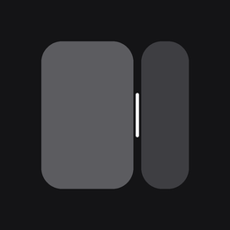
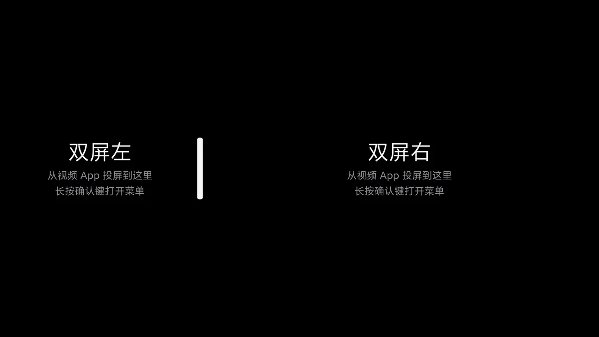
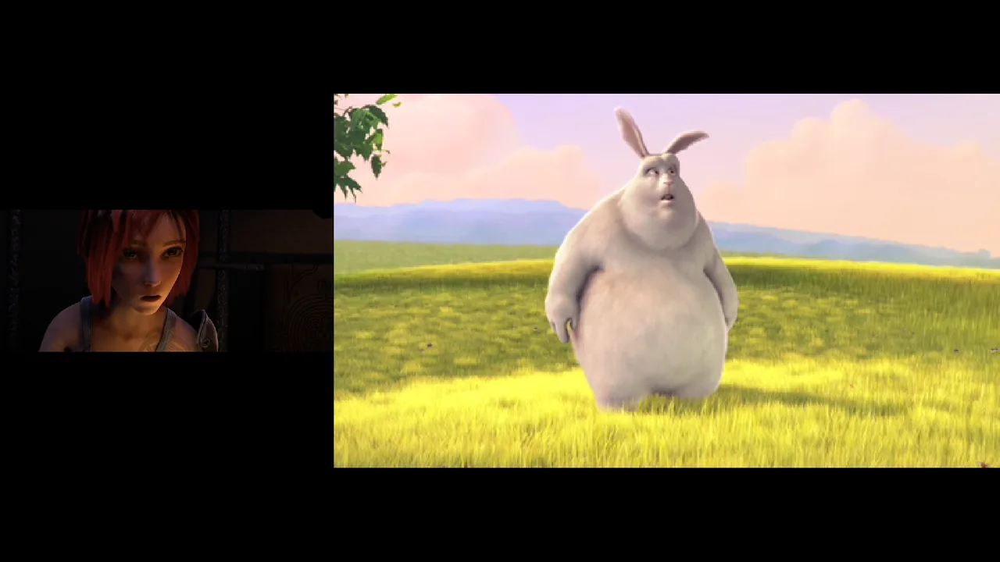
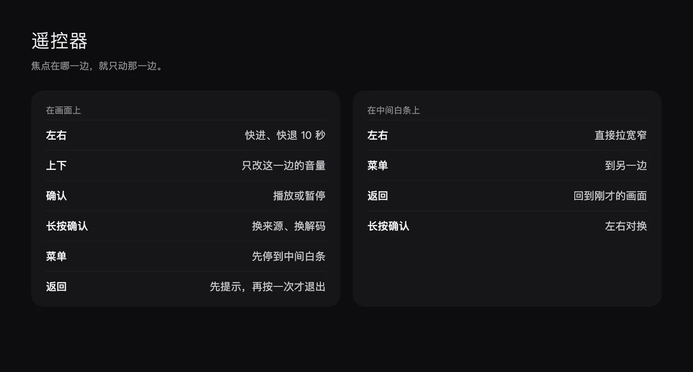
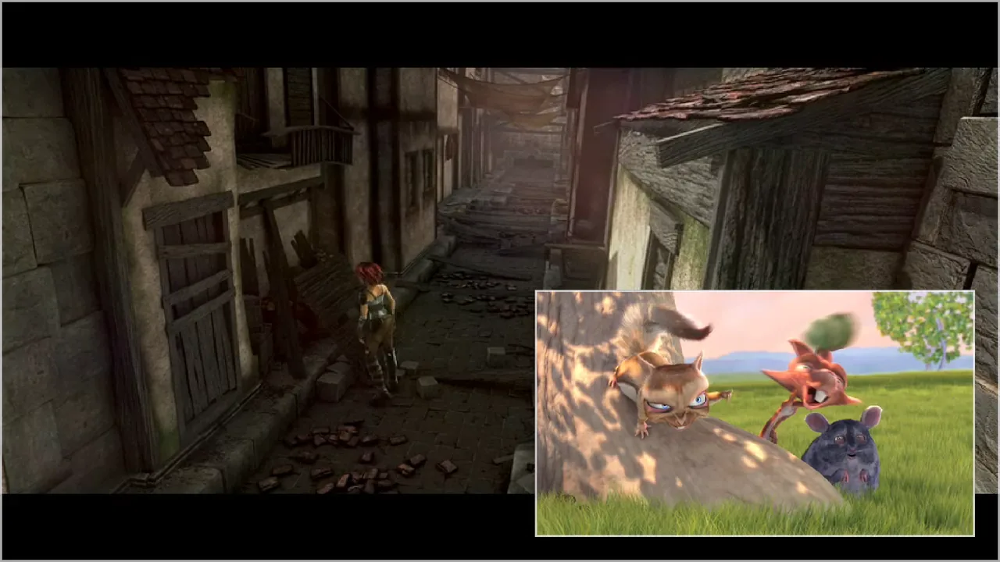

[中文](README.md) | [English](README.en.md)

<div align="center">



# 双屏

**Two pictures on one screen. Audio stays separate.**

One side for a workout, the other for a documentary. Cast from a phone, or play a file already on the TV.


[](docs/demo.mp4)

Recorded on a television. Open it to watch the full clip.

</div>

A player for Android TV. The left and right sides each keep their own position, volume, and hardware or software decoder. A phone's cast list shows two devices: DualPane Left and DualPane Right. This is ordinary DLNA, separate from Miracast, Lebo, and Chromecast.

## After it opens

Each side starts empty. The short white bar between them sets the widths, and the last ratio is kept. Once a picture comes in, the hint steps aside.



## Getting a video in

Keep the phone and the TV on the same LAN, and leave 双屏 open. In a video app's cast list, choose DualPane Left or DualPane Right. The video appears on the side you chose, and focus follows it. Both sides can play together, and both can be heard.

You can also long-press OK on the TV and open a local video from the menu. The first time, the app asks the system for storage permission. It can list mp4, m4v, mov, mkv, webm, ts, and 3gp.

Each side can use a hardware or software decoder on its own. Before the picture appears, a grey line reads "Opening".



## Remote

Left, Right, Up, and Down affect only the focused side. The volume keys on the remote always change the television's own volume.



With nothing playing yet, OK also opens the menu. BACK does not leave at once: "Press BACK again to exit" shows along the bottom, then fades if you leave it.

When the controls slip your mind, Help in the menu runs the guide again.

## Picture-in-picture

Choose Picture-in-picture in the menu and the left side fills the screen, while the right side shrinks to a small window in a corner. The window can take focus: Left and Right seek, Up and Down change that side's volume, and OK plays or pauses.

MENU then only moves focus between the large pane and the window. The layout stays as it is. With the window focused, BACK returns to the large pane first.

Picture-in-picture settings change the window size (Small, Medium, Large) and its place (Bottom right, Top right, Bottom left, Top left). The window's aspect ratio follows the video on the right. Swap sides exchanges the two videos, including where each one had reached. The left side remains the large pane and the right side remains the window. To enlarge whatever is on the right, use that swap. The two sides do not trade places by themselves.

Choose Split screen to leave. The left and right widths return to what they were before picture-in-picture.



## First launch

The first launch walks through the real screen: the two panes, the focused side, the divider, the OK button, and then picture-in-picture. OK or Right continues. Left or BACK goes back one step.

## Install

### Install a release

Download `DualPane-1.0.apk` from [Releases](https://github.com/xfzz7/DualPane/releases).

```
adb install -r DualPane-1.0.apk
adb shell am start -n io.github.xfzz7.dualpane/.MainActivity
```

### Have an agent install it (recommended)

Paste the block below to an agent that can run commands on your computer (WorkBuddy, the Doubao desktop app, the Qwen desktop app, Trae, Claude Code, Codex, and similar tools):

```
Please install the open-source TV app 双屏 on my Android TV.
TV address: <TV IP>:5555

The install notes are in docs/agent.md in the repository.
Read those notes all the way through before you start, then run the commands yourself on my computer. Do not only tell me the steps.
When the TV needs me to tap Allow, stop and tell me. Do not send remote-control keys to the TV.

At the end, follow the section titled 「验收」 and paste the raw output of these commands:
- adb shell pm path io.github.xfzz7.dualpane
- adb shell dumpsys package io.github.xfzz7.dualpane | grep versionName
- adb shell "dumpsys window | grep mCurrentFocus" after the app has started
```

Doubao on a phone, or a chat page in a browser, will only describe the steps. Use a desktop agent that can run commands. When it says the install is done, check that the pasted `mCurrentFocus` contains `io.github.xfzz7.dualpane` and that `versionName` is `1.0`.

The full steps, and what to do when something fails, are in [docs/agent.md](docs/agent.md).

### Build it yourself

You need JDK 17, the Android SDK, and `adb`. On the TV, turn on network debugging in Developer options. Some sets call it ADB debugging. The address looks like `192.168.1.20:5555`.

Put `local.properties` in the repository root. It belongs to this computer. Do not commit it:

```
sdk.dir=/absolute/path/Android/sdk
```

```
./gradlew :app:assembleDebug
adb connect 192.168.1.20:5555
adb install -r app/build/outputs/apk/debug/app-debug.apk
adb shell am start -n io.github.xfzz7.dualpane/.MainActivity
```

The first build downloads Gradle and the dependencies, so it needs a network. On Windows, use `gradlew.bat` in place of `./gradlew`. The `adb` commands stay the same. The package is at `app/build/outputs/apk/debug/app-debug.apk`. If the TV asks you to allow debugging, tap Allow on the TV, then connect again.

The application id is `io.github.xfzz7.dualpane`. The name in the app list is 双屏. When an install cannot replace the copy already on the TV (the signature differs, or the version is lower than the one installed), uninstall first:

```
adb uninstall io.github.xfzz7.dualpane
adb install app/build/outputs/apk/debug/app-debug.apk
```

`minSdk` is 26, `targetSdk` is 28, and `compileSdk` is 34. Playback uses Media3 1.4.1. The interface is Java. Launcher icon sources live in `design/launcher`. The icon packed into the app is under `app/src/main/res/drawable-xhdpi`.

Any device on the same LAN can see DualPane Left and DualPane Right. There is no account between them. It is meant for use at home.

## Where it was tested

The following was tried on this television. It installed, it opened, and it did not crash:

- TV: Xiaomi MiTV_ASTP0
- System: Android 9 (API 28), 1920×1080
- App: 双屏 1.0, debug build
- Install: a computer on the same LAN, over ADB network debugging

Checked on this set: both sides can play at the same time. Pause, seek, separate volume on each side, and playing again after a stop all behave. In picture-in-picture the left side is full screen, the right side is a small window, and both pictures are on screen. The remote's volume keys change the television's master volume. A phone video app has cast to DualPane Left and DualPane Right on this TV. Other brands and other Android versions have not been checked the same way, item by item.

## Footage

The pictures above come from open-movie trailers released by the Blender Foundation under [CC BY 3.0](https://creativecommons.org/licenses/by/3.0/): [Sintel](https://durian.blender.org/) and [Big Buck Bunny](https://peach.blender.org/). The films themselves are not in this repository.

## License

Copyright 2026 xfzz. The code is released under [Apache-2.0](LICENSE).
